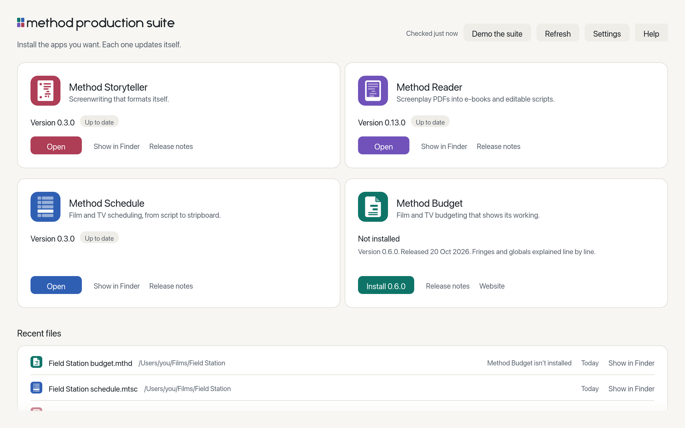
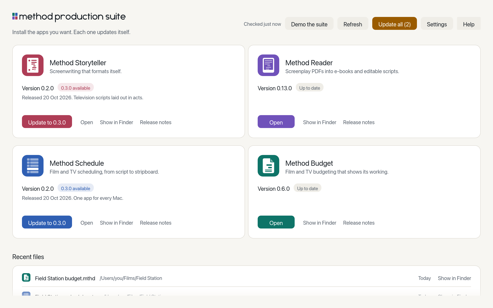

<picture>
  <source srcset="assets/brand/launcher-wordmark-dark.svg" media="(prefers-color-scheme: dark)">
  
</picture>

# Method Launcher

One small app for macOS, Windows and Linux that is the front door to the Method Production
Suite: see the suite's apps, install the ones you want, know when an update is ready, open
them, and open your recent files in the right app. One download instead of four, on
whichever system you use.

- **Install with one click.** Each app comes from its own latest release on GitHub, and is
  checked before anything runs: on a Mac, signed by the suite's Developer ID, notarised and
  with code for your Mac's chip; on Windows and Linux, matched against the release's checksums. If
  a check fails, nothing is installed.
- **Updates in one place.** The launcher shows which apps have a new version and installs
  it the same careful way, one app or all of them, asking before it quits an open app.
- **Your recent files, across the suite.** Scripts, schedules and budgets you opened lately,
  each opening in the app it belongs to.
- **Field Station, ready to open.** Every app's invented sample production, one click away.

<picture>
  <source srcset="assets/screens/apps-dark.png" media="(prefers-color-scheme: dark)">
  
</picture>

<picture>
  <source srcset="assets/screens/updates-dark.png" media="(prefers-color-scheme: dark)">
  
</picture>

## Yours to keep

- Free, and open source under MIT OR Apache-2.0.
- No account, no server of its own, no tracking. It reads the suite's list of apps from
  methodproduction.com and each app's releases from GitHub, and you can turn update checks
  off.
- It never touches your files: it reads the apps' own recent-file lists and hands a file to
  its app.

## Status

See [docs/spec.md](docs/spec.md) for what it does and [docs/ROADMAP.md](docs/ROADMAP.md) for
what comes next.

| Platform | Built | Signed | Tested |
| --- | --- | --- | --- |
| macOS (Apple silicon and Intel) | Installer | Developer ID, notarised | Installs and updates tried with real releases |
| Windows (x64) | Installer | No | Built and tested automatically, not yet tested by a person |
| Linux (x86_64) | .deb and AppImage | No | Built and tested automatically, not yet tested by a person |
| Linux (arm64) | .deb and AppImage, from 0.2.0 | No | Built and tested automatically, not yet tested by a person. The suite's apps have no Linux ARM builds yet, so the launcher shows them and links how to build them. |

## Install

Download the launcher for your system from its
[latest release](https://github.com/method-production-suite/method-launcher/releases/latest):

| System | Download |
| --- | --- |
| macOS (Apple silicon and Intel) | [Method-Launcher-macOS.dmg](https://github.com/method-production-suite/method-launcher/releases/latest/download/Method-Launcher-macOS.dmg) |
| Windows (x64) | [Method-Launcher-windows-x64-setup.exe](https://github.com/method-production-suite/method-launcher/releases/latest/download/Method-Launcher-windows-x64-setup.exe) |
| Linux (Debian, Ubuntu) | [Method-Launcher-linux-amd64.deb](https://github.com/method-production-suite/method-launcher/releases/latest/download/Method-Launcher-linux-amd64.deb) |
| Linux (any x86_64) | [Method-Launcher-linux-x86_64.AppImage](https://github.com/method-production-suite/method-launcher/releases/latest/download/Method-Launcher-linux-x86_64.AppImage) |
| Linux on ARM (Debian, Ubuntu) | [Method-Launcher-linux-arm64.deb](https://github.com/method-production-suite/method-launcher/releases/latest/download/Method-Launcher-linux-arm64.deb) |
| Linux on ARM (any) | [Method-Launcher-linux-aarch64.AppImage](https://github.com/method-production-suite/method-launcher/releases/latest/download/Method-Launcher-linux-aarch64.AppImage) |

On a Mac, open the disk image and drag Method Launcher into Applications. Every release
lists the files' checksums in `SHA256SUMS`.

## Build from source

You need Rust (the version in `rust-toolchain.toml` installs itself through rustup).

```
cargo run -p method-launcher        # the window
cargo run -p launcher-cli -- list   # the command line
cargo xtask ci                      # every check CI runs
```

## Licence

MIT OR Apache-2.0, at your option ([LICENSE-MIT](LICENSE-MIT),
[LICENSE-APACHE](LICENSE-APACHE)). Third-party notices are in [NOTICE](NOTICE).
